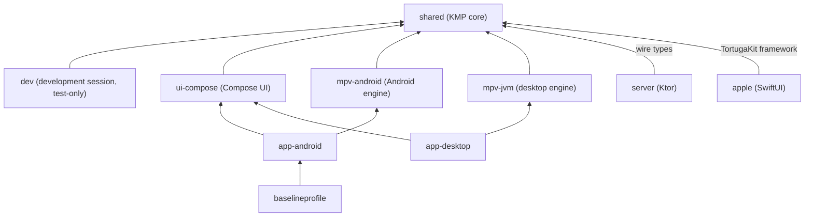

# Architecture

Tortuga shares everything but the views and the OS glue. One Kotlin Multiplatform module, `shared`, holds the addon
client, the data, playback rules, every screen's state, the strings, sync, trackers and watch together. Two UIs render
that state: Compose on Android, Android TV, Windows and Linux, and SwiftUI on iOS, iPadOS, macOS and tvOS. Each
platform plays video with libmpv behind one engine contract. A Ktor server keeps accounts, synced records and tracker
connections.

## Modules

Modules are named by their Gradle projects. `app-android`, `mpv-android` and `baselineprofile` live in `android/`
(`app/`, `mpv/`, `baselineprofile/`), `app-desktop` and `mpv-jvm` in `desktop/` (`app/`, `mpv/`); the others in
folders of their names.

| Module | Targets | Depends on |
|---|---|---|
| `shared` | Android, JVM, iOS, macOS and tvOS (arm64 and the simulators) | nothing in the repository |
| `dev` | the same as `shared` | `shared` (api) |
| `ui-compose` | Android, JVM | `shared` (api) |
| `mpv-android` | Android library | `shared`, mpv-build's `mpv-android` AAR |
| `mpv-jvm` | JVM (JDK 25) | `shared`, the pinned libmpv tarballs |
| `app-android` | Android app | `ui-compose`, `mpv-android`; `dev` in the debug and harness builds only |
| `app-desktop` | JVM app (JDK 25) | `ui-compose`, `mpv-jvm`; `dev` in its harness source set only |
| `baselineprofile` | Android test module | `app-android` |
| `server` | JVM (JDK 27) | `shared`, for the sync protocol's types |
| `gradle/build-logic` | Gradle plugins | `tortuga.strings` (used by `shared`), `tortuga.mpv-artifacts` (used by `mpv-jvm`) |

The Apple apps link `shared` as one static framework, TortugaKit, which the Xcode build makes through Gradle
(`embedAndSignAppleFrameworkForXcode`). Debug builds link `dev`'s framework, which exports `shared` together with the
development session; Release builds link `shared`'s. SKIE exports Kotlin flows to Swift. MPVKit, mpv-build's Swift
package, brings libmpv, FFmpeg and libass as XCFrameworks.

## The shared core

The packages under `shared/src/commonMain/kotlin/com/edde746/tortuga/`:

| Package | Contents |
|---|---|
| `model` | the Stremio types: manifests, meta items, streams, subtitles, deep links; the device's form factor |
| `addons` | the addon transport, the per-profile registry, aggregation across addons, `Loadable` states |
| `net` | the HTTP client and the addon response cache |
| `data` | the SQLDelight database and the repositories over it |
| `playback` | the engine contract, the rules every mpv engine shares, the playback session, stream and subtitle resolution, output, other player apps |
| `presentation` | one store and UI state per screen, and the navigator |
| `input` | `InputKey`, the keymaps for keyboard, mouse, touch and remote, `PlayerCommand`, `WatchCommand` |
| `lang` | language codes as BCP 47 tags, and their names in the platform's locale data |
| `crypto` | the cryptography provider every hash goes through |
| `strings` | the runtime for the generated string accessors (`T`) |
| `sync` | the account, sign-in, device linking, the sync engine, and the protocol (`sync/api`) |
| `trackers` | Trakt, Simkl, MDBList, MyAnimeList and AniList |
| `collections` | collections on Home: folders of addon catalogs and tracker lists, stored as one synced profile setting each, read from and written as Nuvio's collection files |
| `watch` | watch together |
| `kids` | kids profiles: titles' suggested ages from agerating's small database (downloaded from its GitHub releases, checked weekly, looked up on the device), the age cap and a parent's allowed and blocked titles, and the gate every list, page and play goes through |
| `downloads` | offline downloads |
| `secrets` | the `SecretStore` port |
| `log` | logging and the redactor that strips secrets from logs |
| `crash` | when the app sends crash reports through Sentry's SDKs (the release builds send them to a server running edde746/bugs): only a build made with a DSN, only while the device's setting is on, with the report's text scrubbed; the failure boundary every store's and manager's coroutines run in (`FailureBoundary`: in the product a coroutine that throws is logged and reported and the app runs on, in a debug build or a development session it ends the process); on Apple, the hook that hands a Kotlin exception nothing caught to the crash handler |
| `app` | the composition root and the sessions |

`AppBootstrap` builds the process's `AppGraph`: the database, the secret store, the HTTP client, the addon transport
and aggregator, the stream and subtitle resolvers, the trackers and the downloads. Above it, `RootSession` is the
account shell, which shows the splash, sign-in, the profile picker or the app, and `AppSession` is one running
profile, which creates the screens' stores.

## From an addon to the screen

1. `AddonRegistry` holds a profile's installed addons in the user's order and stores them through the `addon_list`
   record. A new profile starts with Cinemeta and OpenSubtitles v3. Each enabled addon's manifest is fetched again
   when the Addons screen opens and, at most once a day, a while after the app comes to the foreground; a manifest
   whose content changed replaces the stored one in place.
2. `AddonTransport` fetches `{base}/{resource}/{type}/{id}[/{extra}].json`, with a response cache and one request per
   URL shared by every caller. Each request ends within 60 seconds and reads at most 32 MiB.
3. `AddonAggregator` picks the addons whose manifest matches the resource, type and id prefix, queries them in
   parallel with a concurrency cap and a per-addon timeout, and emits one `Loadable` state per addon (`Loading`,
   `Ready`, `Error`). One addon's failure affects only its own entry, so screens render partial results.
4. The repositories in `data` keep what the user does with the results: the library, watch progress, the stream last
   played per video, settings.
5. A store per screen (`BoardStore` for Home, `DetailStore`, `StreamsStore`, `LibraryStore`, `PlayerStore`, ...)
   combines them into one `StateFlow` of UI state and takes intents as method calls. The state is complete and
   preformatted: every string, every badge, which menu shows, what covers the video. `TortugaNavigator` keeps a back
   stack per destination (Home, Discover, Search, Library, Settings) and keeps a store alive while its route is on any
   of them.
6. The UIs render that state and send intents. Compose collects the flow (`collectAsState`); SwiftUI observes it
   through `StoreObserver`, one `@Observable` wrapper for every store.

The client plays HTTP(S) streams. Streams that aren't direct links are counted under their addon as streams the app
can't play. Configured addon URLs often carry an account key, so every transport and stream URL is treated as a
secret: the redactor removes them from logs, and the fixture recorder scrubs them.

## Playback

`PlayerEngine` (`shared/.../playback/PlayerEngine.kt`) is the contract every engine implements: commands in (`load`,
`setPaused`, `seek`, `setSpeed`, track selection, subtitle and audio delays, subtitle style, volume, video layout,
audio device) and one `EngineState` out through `PlayerEngineListener.onState` (position, duration, buffering,
tracks, chapters, video and audio info, errors). `MpvLoad` builds the `loadfile` command and its options, and
`MpvState` turns mpv's observed properties into `EngineState`, so every engine follows the same rules.

The implementations:

- **Android** (`mpv-android`, Kotlin): `MpvPlayerEngine` on mpv-build's `mpv-android` library, rendering with
  `vo=mediacodec` and an OSD surface, and falling back to `vo=gpu`.
- **Windows and Linux** (`mpv-jvm`, Kotlin): `MpvPlayerEngine` calls libmpv through FFM bindings generated by
  jextract. On Windows mpv renders with `gpu-next` on D3D11 into a child window under Skiko's DirectComposition
  surface; on Linux it renders through mpv's render API into a framebuffer on Skiko's OpenGL context, under Xwayland
  in a Wayland session.
- **Apple** (`apple/Tortuga/Shared/Mpv/`, Swift): `MpvPlayerEngine` conforms to the Kotlin protocol exported through
  TortugaKit, runs on MPVKit, uses `MpvLoad` and `MpvState` from Kotlin, and draws into an `AVSampleBufferDisplayLayer`
  (`vo=avfoundation`) on every Apple platform.

Above the engine:

- `PlaybackSession` plays a profile's videos in one engine: it resolves the stream (`StreamResolver` follows a stream
  host's redirects and reads the file's size and hash), loads it, falls back to the next stream on failure, adds
  addon subtitles (`SubtitleResolver`) and saves progress.
- `PlayerStore` and `PlayerUiState` hold everything the player screen shows: controls and their auto-hide, scrubbing,
  menus, the skip and up-next prompt, errors and retries.
- Platforms map raw key and remote codes to `InputKey` and forward clicks and taps with their position and count;
  the shared keymaps turn them into `PlayerCommand`s.
- `SkipSegments` finds intros, recaps and credits in the file's chapters: `ChapterMarkerClassifier` (a
  boosted-tree model, shipped as a 164 KB file and walked in plain Kotlin) picks the intro and credits from every
  chapter's title and times, the titles name recaps and previews; the profile's settings say whether the player skips
  them or offers a button.
- Each platform's `AppPlatform.createPlayback()` returns a `PlatformPlayback`: the engine, the media controls (Now
  Playing, MediaSession, SMTC, MPRIS) and the display output.

## Persistence

SQLDelight generates `TortugaDatabase` from the `.sq` files in
`shared/src/commonMain/sqldelight/com/edde746/tortuga/data/db/`. Migrations are numbered `.sqm` files in
`sqldelight/migrations/`, checked against the schema snapshots in `sqldelight/databases/` by
`:shared:verifyCommonMainTortugaDatabaseMigration`. The file is `tortuga.db`, opened by `DatabaseFactory` with each
platform's driver: Android's, the native SQLite driver on Apple, and JDBC SQLite on the desktop.

- Synced tables: `profile`, `addon_list` (with its `addon` rows), `library_item`, `stream_history`, `setting` and
  `stream_pick`. Each row carries a record id, a hybrid logical clock value (`hlc`), the server's version, and dirty
  and deleted flags. `stream_pick` holds each profile's hand picks of streams on all its devices (what the list showed
  around each, the kind of device, network, screen and decoders, and what came of it; no URLs), which stream
  suggestions learn from (`StreamScorer`, every kind of device's picks pooled, learnt in the background and kept in
  memory, `StreamPicks.scorer`); a profile keeps its newest 400 of the last year per kind of device, and a pruned pick
  is a tombstone. Picks are recorded only while the profile's "Suggest a stream" setting
  (`ProfileSetting.StreamSuggestions`, off by default) is on, which is also when the Streams list marks the suggested
  stream; turning it off keeps the picks. Picks stay out of exports.
- Tables that stay on the device: `device_setting` (decoding, display, audio output), the `download*` tables,
  `sync_state`, `hlc_state` and `tracker_write_queue`. `tracker_account` is this device's copy of the account's
  tracker connections.
- Tokens never go into SQLite. `SecretStore` holds the account session and the trackers' access tokens: the Keychain
  on Apple, a Keystore-sealed store on Android, Windows Credential Manager and libsecret on the desktop.

## Accounts and sync

`SyncAccount` signs in with Apple, Google, GitHub or a self-hosted server's OpenID Connect provider, links more
devices by QR code or short code (`tortuga://link?server=…&code=…`), and keeps its session in the `SecretStore`. Each
account holds profiles; addons, and so their account keys, belong to a profile, which can have a PIN, stored as a
salted hash.

`SyncEngine` works offline first. Local writes mark records dirty; the engine pushes them after a short debounce and
pulls pages from its cursor. Merges are last writer wins by the hybrid logical clock, except a library item's
progress, which keeps the furthest `timeWatched` and the latest `lastWatched`. While the app is in front it holds a
Server-Sent Events stream (`/v2/sync/events`) and pulls as soon as another device changes the account.

The protocol lives in `shared/src/commonMain/kotlin/com/edde746/tortuga/sync/api/`; the server compiles against the
same types. Sync is not end-to-end encrypted: the server reads records and seals them at rest
([SECURITY.md](SECURITY.md)).

## Trackers

Trakt, Simkl and MDBList take live scrobbles, watched history and ratings; MyAnimeList and AniList take series
progress and ratings. A connection belongs to the account: the server stores each profile's tokens and is the only
one that refreshes them, and a device fetches the current access token from the server when it needs one.
`TrackerCoordinator` follows each `PlaybackSession`, scrobbling to live trackers and marking the others once the
watched threshold passes. Failed watched and unwatched writes and ratings go into `TrackerWriteQueue`, a persisted
queue that coalesces by intent and replays when the app comes to the front or the network returns. A write the
service refuses five times, or one that can no longer be read, stays there as failed, and Trackers settings counts it
with why the latest failed. MyAnimeList and AniList only issue tokens to a registered redirect, so their sign-in goes
through the server's relay; Trakt, Simkl and MDBList sign in by device code.

## Watch together

Watch together runs on Open Watch Party's relays through its Kotlin SDK, not through Tortuga's server; a device
setting points it at another relay. `WatchTogether` creates, joins and leaves rooms, which people share as a
6-character code or a `tortuga://watch` link. Every participant plays through their own addons: `RoomTitleResolver`
finds the title with the participant's addons, `FileMatcher` ranks their own download and their addons' streams
against the host's file by hash, name and size, and the SDK opens the candidates in turn and picks one by duration.
`WatchPlayback` is the player's side of a room: the host's file becomes the room's media, and a guest's player opens
the chosen file at the room's position.

## Downloads

`DownloadManager` keeps a per-device queue that is never synced. Each attempt resolves the stream again, resumes
partial files and retries a few times. Android downloads in a WorkManager worker, iPhone, iPad and the Mac in a
background `URLSession`, Windows and Linux in the app's process. Apple TV has no downloads.

## Strings

`shared/i18n/<locale>.i18n.json` holds every string in 21 languages, English the base. build-logic's
`tortuga.strings` plugin generates the Kotlin accessors (`T`) into `shared` and the Apple apps' `InfoPlist.strings`.
Stores format their text with `T`, so both UIs show the same words. [CONTRIBUTING.md](CONTRIBUTING.md) has the file
format and the coverage test.

## Platform code

The UIs implement a few ports from `shared`:

- `AppPlatform`: the form factor, `createPlayback`, full screen, opening links, the clipboard, device features,
  other player apps, the licence texts in the app's bundled resources (`bundledTexts`, which About's notice pages
  show). Compose extends it as `TortugaPlatform` with the video surface, picture in picture and file dialogs.
  Implementations: `AndroidPlatform` (`app-android`), the desktop's in `desktop/app/.../Main.kt`,
  `ApplePlatform` (`apple/Tortuga/Shared/App/ApplePlatform.swift`).
- `SignInPlatform`: native Sign in with Apple and Google sheets where they exist, the browser and a loopback or app
  redirect elsewhere, device codes on TVs.
- `SecretStore`, `DownloadPlatform`, `MediaControlsHost` and `PlaybackOutputHost`.

Views, focus handling (the Android TV and tvOS focus engines), image loading (Coil on Compose, Nuke on Apple), picture
in picture and the system media controls stay native.

## The development session

`dev` holds code no release build links: the development session (`--dev` and its options, `DevLaunch`, the same on
every platform: the desktop and Apple apps take them as arguments, Android's debug builds as one string-array launch
extra) that starts one local profile in memory, with options for a test addon, fake trackers, watch progress and
settings; the model of the test report; and the addon fixture recorder. The Apple UI tests, the desktop app's harness
launcher and Android's debug builds start it.

## The server

`server/` is Ktor on Netty with Postgres (HikariCP, Flyway migrations in `server/src/main/resources/db/migration/`),
shipped as one Docker image. The hosted instance at `api.usetortuga.app` and self-hosted instances run the same
image. It keeps:

- accounts, sign-in identities, devices and sessions, and device links;
- the synced records, sealed at rest with the server's data key, with change notices to the account's other devices;
- each profile's tracker connections, whose tokens it refreshes and revokes;
- a relay for the MyAnimeList and AniList sign-ins.

The apps reach addons, streams and watch-together relays directly; none of that passes through the server. Its
packages: `auth` (ID token checks, Apple and GitHub clients), `crypto` (the data key, record sealing), `db`, `http`
(sessions, the byte budget, connection limits), `service` and `routes`. [server/README.md](server/README.md) covers
running, configuring and operating it.
