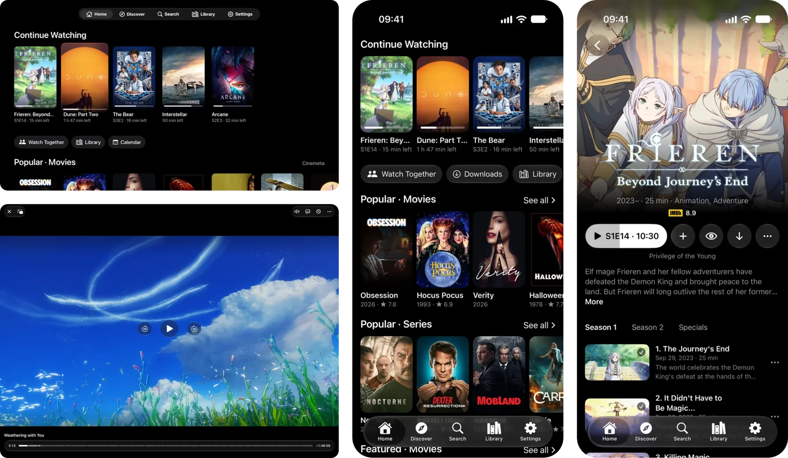

<h1>
  <picture>
    <source media="(prefers-color-scheme: dark)" srcset=".github/readme/mark-dark.svg" />
    
  </picture>
  Tortuga
</h1>

A video player that works with Stremio addons, native on iPhone, iPad, Mac, Apple TV, Android, Android TV, Windows and
Linux. Your addons bring the catalogs and the streams, and Tortuga plays them with mpv. It provides no content of its
own.

<p>
  <a href="https://usetortuga.app">Website</a> ·
  <a href="https://usetortuga.app/#screens">Screenshots</a> ·
  <a href="#download">Download</a> ·
  <a href="CONTRIBUTING.md">Contributing</a> ·
  <a href="LICENSE">Licence</a>
</p>

<p align="center">
  
</p>

## Download

Tortuga 1.0.0 is out in [GitHub releases](https://github.com/edde746/tortuga/releases/latest). The stores' versions are
in review.

| Platform | Requires | Where |
| --- | --- | --- |
| iPhone and iPad | iOS and iPadOS 17 or later | App Store |
| Apple TV | tvOS 17 or later | App Store |
| Mac | macOS 14 or later, Apple silicon | A notarized DMG in GitHub releases |
| Android phones and tablets | Android 8.0 or later | Google Play, and APKs in GitHub releases |
| Android TV (Google TV, NVIDIA SHIELD) | Android 8.0 or later | Google Play |
| Fire TV | Android 8.0 or later | Amazon Appstore |
| Windows | 64-bit (x64) | Microsoft Store, and a portable zip in GitHub releases |
| Linux | A Wayland session | Flatpak bundles (x64, arm64) in GitHub releases |

Or [build it from source](#building-from-source).

## Features

###  Browse & Discover
- Install any Stremio addon by its link; catalogs, search results, detail pages and streams all come from your addons
- Home with Continue Watching and your addons' catalogs
- Collections: group catalogs and tracker lists into folders, shown as a row of tiles on Home
- Discover by type, with the filters each catalog offers, such as genre
- Search across every addon that offers it
- A library that keeps your progress and watched marks
- Detail pages with ratings from the trackers you connect

###  Streams
- A title's streams grouped by addon, filtered by quality, dynamic range (SDR, HDR, Dolby Vision), video codec, file
  size and your own patterns
- Tortuga remembers the stream you picked and plays the next episode from the same source
- Play automatically: skip the stream list with the first stream that passes the filters, or the same stream as last
  time
- Suggest a stream, off by default: learns which streams you pick on a profile and marks one in the list

###  Playback
- mpv (libmpv) on every platform
- HDR10 and Dolby Vision where the device supports them[^hdr]
- Audio passthrough of Dolby Atmos and DTS to your receiver[^pass]
- Embedded and addon subtitles, matched by OpenSubtitles hash
- Two subtitles at once: a second one at the top of the picture, chosen in the player or by its own language setting
- Your audio and subtitle choices carry to the next episode
- Chapters on the scrub bar; skip intros, recaps and credits with a button or automatically
- Intros and credits found in a file's chapters by an on-device classifier, also where the chapters are only numbered
- Up next, previous and next episode
- Playback speed, subtitle delay and audio delay
- Picture in picture[^pip]
- Refresh-rate matching[^rate]
- Rather use another player? Send the stream to VLC, mpv (not on iPhone, iPad or Apple TV), Infuse (Apple devices),
  Kodi (Android and Android TV), IINA (the Mac), any other player on the device or one you set up; progress is still
  recorded where that app reports it

###  Downloads
- Save movies and episodes with their subtitles to watch offline[^dl]
- Keep a series topped up with its next unwatched episodes
- Download over Wi-Fi only, if you choose

###  Watch Together
- Rooms on [Open Watch Party](https://openwatch.party): share the room's 6-character code or an invite link[^invite]
- Playback stays in sync, and each person plays the same title through their own addons, also with friends on other
  Open Watch Party apps
- The host controls playback, or everyone does
- Open Watch Party's public relays, or a relay you choose

###  Sync & Profiles
- Sign in with Apple, Google or GitHub; your profiles, addons, library, progress and profile settings sync across every
  device
- Link a TV with a QR code or a code
- Sync runs on Tortuga's hosted server unless you choose another, such as [one you run yourself](server/README.md)
- A profile for each person in the household, with its own name and avatar, its own addons in order, its library and
  its settings; a PIN is optional
- Kids profiles with a suggested-age limit from [agerating](https://github.com/edde746/agerating)

###  Trackers & Integrations
- Trakt, Simkl and MDBList: live scrobbling, watched history, ratings and watchlists, and your lists on Trakt and
  MDBList
- MyAnimeList and AniList: series progress, ratings and planning lists
- Continue Watching on the TV's home screen: Android TV's Watch Next row and Apple TV's Top Shelf[^home]
- The system's media controls: Now Playing on Apple devices, the media session on Android, SMTC on Windows and MPRIS
  on Linux
- Discord Rich Presence, off by default[^discord]
- [`stremio:` and `tortuga:` links](#links) open titles, install addons and join rooms

###  Platforms
- SwiftUI on Apple devices; Compose on Android, Android TV, Windows and Linux; one shared Kotlin core under all of them
- Full D-pad and remote navigation on Android TV and Apple TV
- Keyboard shortcuts and media keys on the desktop
- 21 languages: English, Spanish, Brazilian Portuguese, Arabic, French, German, Turkish, Russian, Indonesian, Hindi,
  Italian, Polish, Japanese, Korean, Vietnamese, Thai, Ukrainian, Dutch, Romanian, Czech and Swedish
- No ads and no analytics. Crash reports carry no account and no addon links, and one switch turns them off
  ([privacy policy](https://usetortuga.app/privacy/))

[^hdr]: Not on Linux.
[^pass]: Android and Android TV pass through what the device and the TV or receiver report taking (Dolby Digital,
    Dolby Digital Plus, TrueHD, DTS, DTS-HD); Windows and Linux all five. On Apple devices the system's decoder takes
    Dolby Digital and Dolby Digital Plus, and on iOS and tvOS 26 also TrueHD and DTS-HD for spatial audio.
[^pip]: iPhone, iPad, the Mac, and Android phones and tablets.
[^rate]: Every platform tells the system the video's frame rate, and the system's own setting decides (Android's Match
    content frame rate, Apple TV's Match Content). Force frame rate switching switches the display itself on Android
    TV, Windows and the Mac (in full screen).
[^dl]: Not on Apple TV.
[^invite]: An invite link opens Tortuga on Apple devices and Android; on Windows and Linux, paste it into the app.
[^home]: Not on Fire TV.
[^discord]: Windows, Linux and the Mac.

## Links

Tortuga opens these links from outside the app: from a web page, another app, a script or an automation.

| Link | Does |
| --- | --- |
| `stremio://<host>/<path>/manifest.json` | Shows the install preview of the addon at `https://<host>/<path>/manifest.json` |
| `stremio:///detail/<type>/<id>` | Opens a title's page; `/<videoId>` after it opens that episode's streams, and `?autoPlay=true` plays it |
| `stremio:///search?query=<text>` | Searches your addons |
| `stremio:///board`, `stremio:///discover`, `stremio:///library` | Opens Home, Discover or the library |
| `tortuga://watch?code=<code>` | Joins a watch-together room; an invite on another relay adds `&relay=<url>` |
| `tortuga://link?server=<url>&code=<code>` | A new device's sign-in QR code, scanned with a phone: opens Settings → Account to approve the device |

Android and Apple devices handle all of them. On Windows and Linux the installed app (MSIX and Flatpak) handles
`stremio:` links; paste a watch-together invite into the app. The Android debug build (Tortuga Dev) registers none of
them.

```sh
# Android and Android TV, over adb
adb shell am start -a android.intent.action.VIEW -d "stremio:///detail/series/tt0903747"
# macOS
open "tortuga://watch?code=<code>"
# Linux
xdg-open "stremio:///search?query=heist"
```

On iPhone and iPad, use the Open URLs action in Shortcuts.

## Building from Source

Tortuga is one repository: a Kotlin Multiplatform core in `shared/`, a Compose UI for Android, Android TV, Windows and
Linux, SwiftUI apps for iOS, iPadOS, macOS and tvOS, and a Ktor sync server. Gradle needs a JDK, 17 or newer, and
fetches the toolchains and the pinned libmpv itself. [CONTRIBUTING.md](CONTRIBUTING.md) lists every prerequisite and
every build and test command.

```sh
git clone https://github.com/edde746/tortuga.git
cd tortuga
```

<details>
<summary>Android and Android TV</summary>

With the Android SDK (platform 37, through `ANDROID_HOME` or `local.properties`):

```sh
./gradlew :app-android:assembleDebug
```

One APK for phones, tablets and TVs, in `android/app/build/outputs/apk/debug/`. It installs as "Tortuga Dev"
(`com.edde746.tortuga.dev`) beside a release build.

</details>

<details>
<summary>Windows and Linux</summary>

```sh
./gradlew :app-desktop:run
./gradlew :app-desktop:createDistributable
```

`run` starts the Compose Desktop app; Linux needs a Wayland session. `createDistributable` writes the app image to
`desktop/app/build/compose/binaries/main/app/`. Without an Android SDK, add `-Ptortuga.android=false`.

</details>

<details>
<summary>iPhone, iPad, Mac and Apple TV</summary>

On an Apple silicon Mac with Xcode:

```sh
xcodegen=$(tools/install_xcodegen.sh /tmp/tortuga-tools)
cd apple && "$xcodegen" generate
xcodebuild -project Tortuga.xcodeproj -scheme Tortuga-iOS -configuration Debug -destination 'generic/platform=iOS Simulator' CODE_SIGNING_ALLOWED=NO build
xcodebuild -project Tortuga.xcodeproj -scheme Tortuga-tvOS -configuration Debug -destination 'generic/platform=tvOS Simulator' CODE_SIGNING_ALLOWED=NO build
xcodebuild -project Tortuga.xcodeproj -scheme Tortuga-macOS -configuration Debug -destination 'platform=macOS,arch=arm64' CODE_SIGNING_ALLOWED=NO build
```

`tools/install_xcodegen.sh` downloads the pinned XcodeGen and checks it. Each build runs Gradle first to link the
shared Kotlin framework. To run on your own iPhone, iPad or Apple TV, set `DEVELOPMENT_TEAM` to your team.

</details>

<details>
<summary>Sync server</summary>

`server/` is the sync server: Kotlin (Ktor) and Postgres in Docker.

```sh
cp server/.env.example server/.env        # set POSTGRES_PASSWORD at least
(umask 077; set -C; openssl rand 32 > server/tortuga-data.key)
sudo chown 10001 server/tortuga-data.key  # the server's user in the container
docker compose -f server/compose.yaml up -d --build
curl http://127.0.0.1:8080/v2/info
```

[server/README.md](server/README.md) covers configuration, sign-in, backups and the reverse proxy in front of it.

</details>

## Contributing

[CONTRIBUTING.md](CONTRIBUTING.md) covers the prerequisites, building and testing, strings and translations, and pull
requests.

## Licence

Tortuga is licensed under the GNU General Public License, version 3 only (GPL-3.0-only): see [LICENSE](LICENSE). The
app's About screen lists the third-party components and their licences.

## Support

[usetortuga.app/support](https://usetortuga.app/support/) and support@usetortuga.app. Bugs and feature requests go in
[GitHub issues](https://github.com/edde746/tortuga/issues); security problems go through [SECURITY.md](SECURITY.md).

## Acknowledgments

- Playback by [mpv](https://mpv.io) (libmpv) on every platform, built by [edde746/mpv-build](https://github.com/edde746/mpv-build)
- Speaks the [Stremio addon protocol](https://github.com/Stremio/stremio-addon-sdk/blob/master/docs/protocol.md)
- Watch together on [Open Watch Party](https://openwatch.party)
- Built with [Kotlin Multiplatform](https://kotlinlang.org/docs/multiplatform.html),
  [Compose Multiplatform](https://www.jetbrains.com/compose-multiplatform/),
  [SwiftUI](https://developer.apple.com/xcode/swiftui/), [Ktor](https://ktor.io) and
  [SQLDelight](https://github.com/sqldelight/sqldelight)
- Anime IDs mapped with [Fribb/anime-lists](https://github.com/Fribb/anime-lists) and
  [Anime-Lists/anime-lists](https://github.com/Anime-Lists/anime-lists), packed by
  [edde746/anime-mappings](https://github.com/edde746/anime-mappings)
